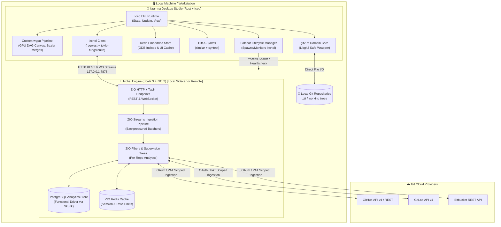
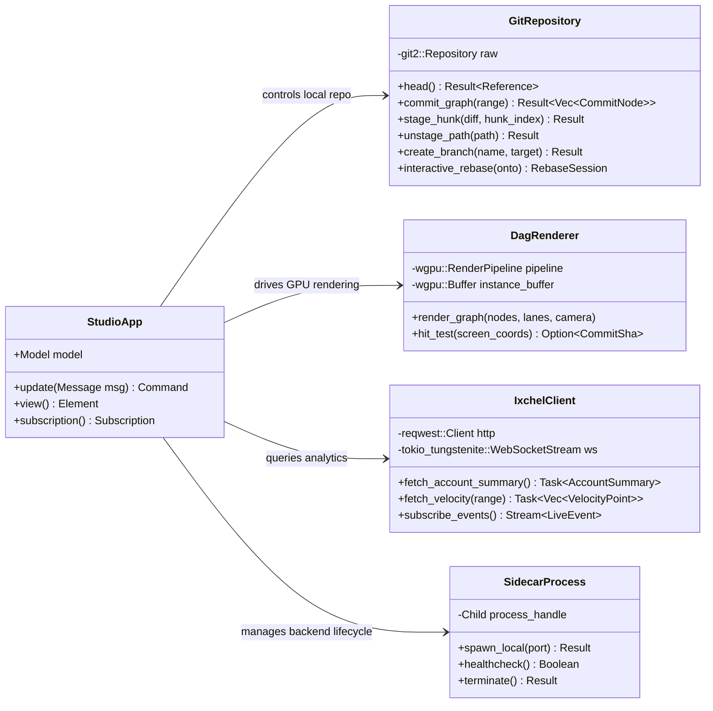
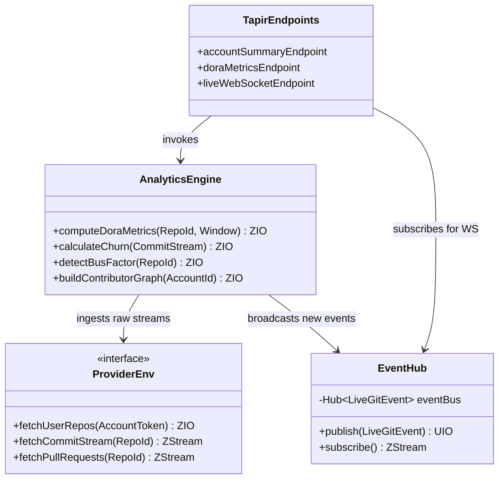

# 🔱 Itzamna & 🌙 Ixchel

> **A Pantheon for Version Control**: A GPU-accelerated desktop Git studio paired with a reactive functional Git analytics engine.

[](https://opensource.org/licenses/MIT)
[](https://www.rust-lang.org/)
[](https://github.com/iced-rs/iced)
[](https://www.scala-lang.org/)
[](https://zio.dev/)

---

## 🏛️ Mythological Thematic Foundation

In Maya cosmology, **Itzamná** is the supreme creator deity, lord of knowledge, writing, wisdom, and the cosmic order — the ruler of day and heavens. **Ixchel** is the goddess of the moon, tides, medicine, cycles, and textile weaving — the master who takes disparate threads and weaves them into unified tapestries.

This duality drives the architecture:
- **Itzamna (☀️ The Studio)**: Direct mastery over the repository. It writes, manipulates, stages, branches, merges, and visualizes the commit DAG with GPU-accelerated clarity.
- **Ixchel (🌙 The Oracle)**: Continuous account-level analytical synthesis. It mines your full identity history across GitHub, GitLab, and Bitbucket, weaving disparate commit threads and review cycles into deep engineering intelligence.

---

## 🌌 High-Level System Architecture



---

## 🛠️ The Two Pillars: Tech Stacks

### 1. Itzamna — The Git Studio (Desktop)

A zero-Electron, 100% native client compiled down to a single compact binary with instant startup and negligible memory footprint.

| Layer | Technology | Purpose & Rationale |
| :--- | :--- | :--- |
| **Language** | **Rust (2024 Edition)** | Memory safety, zero-cost abstractions, maximum concurrency control. |
| **GUI Framework** | **Iced (0.13+)** | Elm-inspired pure architecture (`Message -> Model -> View`). Pure state-machine paradigm. |
| **DAG Renderer** | **wgpu + Custom WGSL Shaders** | Direct GPU instanced commit node rendering, animated bezier lanes, smooth 144 FPS panning/zooming over 100k+ commits. |
| **Git Engine** | **git2-rs (libgit2)** | Battle-tested programmatic access to ODB, trees, commits, refs, stashes, and submodules. |
| **Embedded Storage** | **Redb** | Pure Rust ACID typed key-value table store for caching parsed commit lanes and blame caches. |
| **Async Runtime** | **Tokio** | Asynchronous IO, background fetches, and fiber-like task coordination. |
| **File Watcher** | **notify** | Cross-platform filesystem event streaming for instantaneous UI refresh upon external changes. |
| **Diff Engine** | **similar** | Rich diffing with character, word, and line-level granularity. |
| **Syntax Highlighting** | **syntect** | Sublime Text/TextMate grammar engine for syntax-highlighted diffs and blame views. |
| **Credentials** | **keyring** | Secure OS keychain integration for storing provider tokens and SSH secrets. |

---

### 2. Ixchel — The Analytics Oracle (Backend)

An account-scoped analytical engine running on the JVM that models asynchronous, resilient, concurrent workflows through typed functional effects.

| Layer | Technology | Purpose & Rationale |
| :--- | :--- | :--- |
| **Language** | **Scala 3** | Advanced type system (union types, opaque types, context functions, derivation). |
| **Effect Runtime** | **ZIO 2** | Purely functional, type-safe effect system with structured concurrency and fiber supervision. |
| **HTTP & Routing** | **ZIO HTTP + Tapir** | Declarative type-safe endpoints with automatic OpenAPI / Swagger generation. |
| **GraphQL Engine** | **Caliban** | ZIO-native GraphQL execution engine for flexible, nested analytics queries. |
| **Stream Processing** | **ZIO Streams** | Non-blocking, backpressured streaming for parsing and aggregating voluminous git event logs. |
| **Persistence** | **Skunk + PostgreSQL** | Pure functional, non-blocking PostgreSQL client (no legacy JDBC overhead). |
| **Caching Layer** | **ZIO Redis** | Hot rate-limit counters, provider token caching, and ephemeral metrics buffering. |
| **Scheduling** | **ZIO Schedule** | Expressive, jittered, resilient polling and synchronization policies. |
| **Build Tool** | **Mill** | Modern, lightning-fast, reproducible Scala build pipeline. |

---

## 📐 Modularity & UML Architecture

### Itzamna Core Domain Class Diagram



### Ixchel Effect Flow & Data Model



---

## 🚀 Key Feature Matrix

### 🌟 Itzamna (Desktop Studio)
- **GPU-Accelerated Commit DAG**:
  - Topological branch routing with cubic bezier curves.
  - Interactive lane folding, branch merging animations, and tag badges.
  - Smooth virtualized rendering capable of navigating multi-decade histories (Linux/Chromium scale).
- **Surgical Staging & Diffing**:
  - Intra-line character-level diff highlighting.
  - Interactive line-by-line and hunk-by-hunk staging/discarding.
  - Conflict resolution workbench with 3-way merge and inline accept/reject tools.
- **Deep Git Tooling**:
  - Visual interactive rebase (drag-and-drop squashing, rewording, dropping, editing).
  - Stash management with visual diffs and drop/pop inspector.
  - Worktree management (create, switch, and delete working trees without context switches).
  - Submodule recursive inspection and status indicators.
- **Local Embedded Cache**:
  - Pre-calculated blame and file tree indices stored in `redb`.

### 🔮 Ixchel Integration (Inside Itzamna)
- **Account-Wide Health & Radar**:
  - Multi-account identity switcher (Work GitHub, Personal GitHub, GitLab, Self-Hosted).
  - High-level repository health radar: CI pass rate, issue triage latency, active contributor counts.
- **DORA Metric Dashboard**:
  - Deployment Frequency, Lead Time for Changes, Change Failure Rate, Time to Restore Service.
- **Code Churn & Bus Factor Heatmap**:
  - Treemap visualizer pinpointing single-contributor dependencies and volatile hotspots.
- **Contributor Influence Graph**:
  - GPU-accelerated force-directed graph illustrating team collaboration clusters and cross-review velocity.
- **Real-Time Cosmic Event Stream**:
  - Live activity feed showing PR reviews, remote pushes, and deployment status updates pushed over WebSockets.

---

## 🔌 API & Integration Contract

Ixchel exposes both RESTful JSON endpoints and WebSocket streams documented via OpenAPI:

| Method | Endpoint | Description |
| :--- | :--- | :--- |
| `POST` | `/api/v1/auth/{provider}/exchange` | Exchanges OAuth code / PAT for encrypted session token |
| `GET` | `/api/v1/account/summary` | Account-wide statistics, active repos, aggregate velocity |
| `GET` | `/api/v1/account/repos` | Repositories with derived health and maintenance scores |
| `GET` | `/api/v1/analytics/velocity` | Rolling commit velocity and PR throughput time-series |
| `GET` | `/api/v1/analytics/churn` | Code churn analysis breakdown by file/directory/author |
| `GET` | `/api/v1/analytics/dora` | Calculated DORA metrics across selected project scopes |
| `GET` | `/api/v1/analytics/contributors`| Force-directed graph nodes and links representing collaboration |
| `WS` | `/api/v1/stream/events` | Real-time push of external webhook-backed repo and review events |
| `WS` | `/api/v1/stream/metrics` | Live recalculations of metrics as new commits land |

---

## 📦 Project Directory Layout

```
Itzamna/
├── .github/
│   └── workflows/                # CI/CD pipelines
├── itzamna-desktop/              # Rust Native Desktop App
│   ├── Cargo.toml
│   ├── src/
│   │   ├── main.rs               # Application entrypoint
│   │   ├── app.rs                # Iced Application & Update loop
│   │   ├── git/                  # git2-rs safe abstraction layer
│   │   │   ├── mod.rs
│   │   │   ├── repository.rs
│   │   │   ├── dag.rs            # Commit node & lane builder
│   │   │   ├── staging.rs        # Index manipulation
│   │   │   └── rebase.rs         # Interactive rebase engine
│   │   ├── render/               # wgpu custom shader pipeline
│   │   │   ├── mod.rs
│   │   │   ├── pipeline.rs
│   │   │   └── shaders/          # WGSL DAG shaders
│   │   ├── views/                # Iced UI components
│   │   │   ├── dag_view.rs
│   │   │   ├── diff_view.rs
│   │   │   ├── staging_view.rs
│   │   │   └── analytics_view.rs # Ixchel dashboard renderer
│   │   ├── storage/              # Redb persistence layer
│   │   └── client/               # Ixchel REST & WebSocket client
│   └── assets/                   # Mayan-inspired glyphs, themes, icons
│
├── ixchel-backend/               # Scala 3 + ZIO 2 Analytics Engine
│   ├── build.sc                  # Mill build definition
│   ├── src/
│   │   └── ixchel/
│   │       ├── Main.scala        # ZIO App entrypoint
│   │       ├── api/              # Tapir endpoints & HTTP/WS routes
│   │       ├── domain/           # Scala 3 domain models & opaque types
│   │       ├── engine/           # Analytics, DORA, churn, and graph logic
│   │       ├── providers/        # GitHub, GitLab, Bitbucket clients
│   │       ├── db/               # Skunk PostgreSQL persistence
│   │       └── stream/           # ZIO Streams & live EventHub
│   └── resources/
│       └── application.conf
│
├── docs/                         # Architecture RFCs & Theme Guides
├── LICENSE                       # MIT License
└── README.md
```

---

## 🗺️ Roadmap & Milestones

- [x] **Phase 0: Genesis & Conception**
  - Architecture definition and dual-stack selection.
  - Maya mythological thematic alignment.
  - Repository initialization.
- [ ] **Phase 1: The Obsidian Core (Itzamna MVP)**
  - `git2-rs` local workspace wrapper.
  - `Iced` workspace layout (file tree, commit list, diff panel).
  - Custom `wgpu` canvas drawing basic topological commit DAGs.
  - Staging area with hunk-level stage/unstage.
- [ ] **Phase 2: The Moon Weaver (Ixchel Core)**
  - ZIO 2 HTTP + Tapir server setup.
  - GitHub provider integration (PAT authentication + commit ingestion).
  - PostgreSQL schema and Skunk migrations for analytics storage.
  - Basic velocity and churn computation endpoints.
- [ ] **Phase 3: The Celestial Conjunction (Integration)**
  - Embedded sidecar process supervisor inside Itzamna.
  - Native analytics panel in Itzamna consuming Ixchel's endpoints.
  - Interactive rebase visual workbench.
  - Three-way merge and visual conflict resolver.
- [ ] **Phase 4: Transcendence (Advanced Studio & Oracle)**
  - Force-directed contributor graph with GPU acceleration.
  - GitLab and Bitbucket provider parity.
  - Live WebSocket telemetry and real-time dashboard updates.

---

## 📄 License

This project is licensed under the [MIT License](LICENSE).
